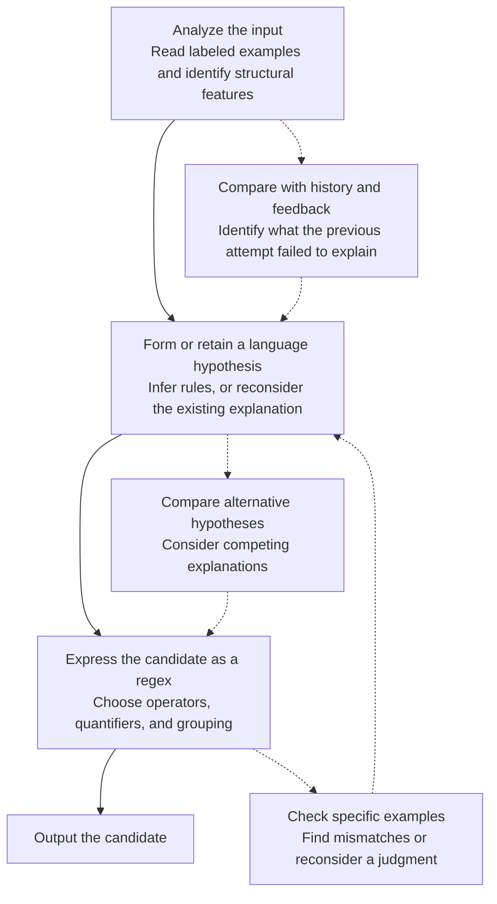

This diagram summarizes the saved analysis for full-pipeline configurations that enable both reflection and the repair loop. Solid edges show a coarse shared backbone for traces that reach a candidate. Dashed edges show optional activities and returns. They do not encode transition probabilities, and their placement does not imply a fixed temporal order in every passage.

The solid backbone is an abstraction across completed traces. It does not assert that every call explicitly verbalizes every stage, completes the backbone, or follows its order exactly. Incomplete and repetitive passages can stop earlier. Some analysis discusses examples and rules without producing an extractable prediction.

The optional branches describe observable activities:

- **History and feedback comparison:** explicitly discussing the previous regex, new counterexamples, or reported accuracy. A passage can discuss feedback and still retain its previous candidate.
- **Alternative-hypothesis comparison:** considering different explanations, such as length, character categories, substring requirements, or repetition counts, and rejecting or retaining them using examples.
- **Detailed example checking:** manually testing or recounting examples. A detected conflict can lead back to rule inference; the model can also reaffirm the existing rule. These checks can themselves be wrong.

Reading character-class notation, counting blocks, and rereading strings are included under input analysis. Operator translation, syntax adjustments, and output formatting are included under regex construction and output. Repetition is a behavior that can occur within these activities, rather than a required stage or a separate productive branch. Compilation and equivalence checking by the external program are outside this diagram.

**Audit scope.** A fresh per-call scan covers 922 files in the two original scaleup directories: the explicit `agentic_reflection` configurations and the `agentic_no_clustered` experiment families whose prompts demonstrate both mechanisms. Selecting configurations rather than requiring both prompt markers in each individual file retains runs that finished before a later reflection round or repair retry was needed. Single inference, no-reflection, no-repair-loop, and candidate-batch configurations are excluded. Other historical directory aliases without sufficient configuration evidence are not included.

The scan retains 14,455 log records. Of these, 11,311 contain an analysis passage, and 265 of those have no extracted prediction. The remaining 3,144 records do not expose the comparable analysis format; their final `<reasoning>` summaries are not used to reconstruct hidden analysis. The saved analysis passages in this scope are from GPT-OSS. A record is not assumed to be a separately verified model invocation merely because it is present in `Logs`.

[full_pipeline_call_audit.csv](full_pipeline_call_audit.csv) records the location and text indicators for every retained call record; [full_pipeline_call_audit.json](full_pipeline_call_audit.json) provides counts by configuration. Lexical indicators are broad search cues, not semantic stage annotations. In particular, mentioning “accept” or “reject” can be a restatement of the task rather than an actual example check. Consequently, the audit supports corpus coverage but does not prove a detailed stage sequence common to every passage. The distinction between the shared backbone and optional branches remains a qualitative synthesis grounded in the inspected traces and [source excerpts](full_pipeline_evidence.json).
